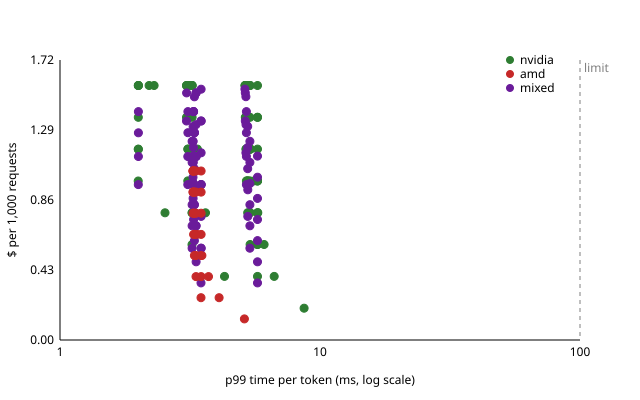

# Which GPUs should you rent for `azure2023_conv.jsonl`?

> **MODELLED, NOT MEASURED.** These numbers come from gpumix's speed model with ideal
> GPU efficiency. They have not been checked against real GPU runs yet.

## Traffic

- 19,366 requests over 3,502 s (5.5 per second)
- Median prompt 1,020 tokens, median answer 129 tokens
- Model: `qwen3-8b`

## Latency target

99% of requests get their first token within 2000 ms, and 99% of
requests average under 100 ms per token after that.

## Cheapest setups that meet it (420 of 420 pass)

| # | Setup | Provider | $ / 1k requests | $ / M output tokens | p99 first token | p99 per token |
|--:|--|--|--:|--:|--:|--:|
| 1 | 1x MI300X | digitalocean | 0.13 | 0.62 | 72 ms | 5.1 ms |
| 2 | 1x MI300X | crusoe | 0.17 | 0.82 | 72 ms | 5.1 ms |
| 3 | 1x H100-SXM | crusoe | 0.20 | 0.93 | 102 ms | 8.7 ms |
| 4 | 1x H100-SXM | digitalocean | 0.22 | 1.05 | 102 ms | 8.7 ms |
| 5 | 2x MI300X | digitalocean | 0.26 | 1.23 | 55 ms | 4.1 ms |
| 6 | 1x MI300X prefill + 1x MI300X decode over infinity-fabric-mi300x | digitalocean | 0.26 | 1.23 | 82 ms | 3.5 ms |
| 7 | 2x MI300X | crusoe | 0.35 | 1.64 | 55 ms | 4.1 ms |
| 8 | 1x MI300X prefill + 1x MI300X decode over infinity-fabric-mi300x | crusoe | 0.35 | 1.64 | 82 ms | 3.5 ms |
| 9 | 1x H100-SXM prefill + 1x MI300X decode over infiniband-400g | digitalocean | 0.35 | 1.67 | 113 ms | 3.5 ms |
| 10 | 1x MI300X prefill + 1x H100-SXM decode over infiniband-400g | digitalocean | 0.35 | 1.67 | 88 ms | 5.8 ms |

## Cost against speed

One dot per setup, at its cheapest provider. Filled dots meet both limits; hollow dots
miss at least one. Green is NVIDIA only, red is AMD only, purple mixes both.

## What the model assumes

- **Ideal speed.** Each step takes as long as the GPU's math or memory reads need at full
  spec (vendor dense BF16 TFLOPS and memory bandwidth). Real GPUs are slower.
- **vLLM-style serving.** Continuous batching with chunked prefill, using vLLM's default
  token budget and batch size for each GPU. Requests are routed round robin.
- **Prefill/decode splits** move the KV cache over NVLink or Infinity Fabric inside one
  machine, or 400G InfiniBand between vendors, at full link speed.
- **Tensor parallelism** only on H100, with a measured all-reduce delay from nccl-tests
  (NVIDIA/nccl#1259). No measured MI300X number was found, so MI300X runs without it.
- **Latency limits** are MLPerf's for Llama 3.1 8B (`loadgen/mlperf.conf`).
- **Prices** are on-demand $/GPU-hour from each provider's pricing page; each GPU is
  billed for the whole run, idle time included. Sources and dates: `prices.yaml`.
