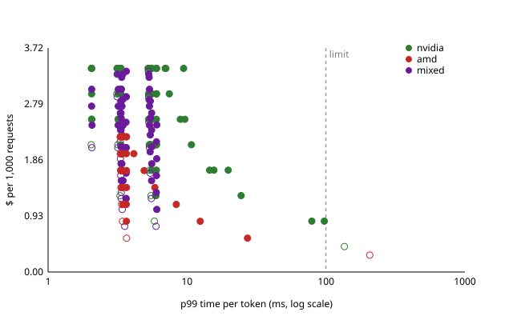

# Which GPUs should you rent for `azure2023_code.jsonl`?

> **MODELLED, NOT MEASURED.** These numbers come from gpumix's speed model with ideal
> GPU efficiency. They have not been checked against real GPU runs yet.

## Traffic

- 8,819 requests over 3,436 s (2.6 per second)
- Median prompt 1,469 tokens, median answer 13 tokens
- Model: `qwen3-8b`

## Latency target

99% of requests get their first token within 2000 ms, and 99% of
requests average under 100 ms per token after that.

## Cheapest setups that meet it (344 of 420 pass)

| # | Setup | Provider | $ / 1k requests | $ / M output tokens | p99 first token | p99 per token |
|--:|--|--|--:|--:|--:|--:|
| 1 | 2x MI300X | digitalocean | 0.56 | 20.11 | 179 ms | 27.3 ms |
| 2 | 2x MI300X | crusoe | 0.75 | 26.79 | 179 ms | 27.3 ms |
| 3 | 3x MI300X | digitalocean | 0.84 | 30.16 | 112 ms | 12.4 ms |
| 4 | 2x MI300X prefill + 1x MI300X decode over infinity-fabric-mi300x | digitalocean | 0.84 | 30.16 | 188 ms | 3.7 ms |
| 5 | 1x H100-SXM TP2 | crusoe | 0.84 | 30.28 | 709 ms | 79.1 ms |
| 6 | 2x H100-SXM | crusoe | 0.84 | 30.28 | 357 ms | 97.3 ms |
| 7 | 1x H100-SXM TP2 | digitalocean | 0.95 | 34.24 | 709 ms | 79.1 ms |
| 8 | 2x H100-SXM | digitalocean | 0.95 | 34.24 | 357 ms | 97.3 ms |
| 9 | 2x MI300X prefill + 1x H100-SXM decode over infiniband-400g | digitalocean | 1.04 | 37.23 | 195 ms | 6.1 ms |
| 10 | 3x MI300X | crusoe | 1.12 | 40.18 | 112 ms | 12.4 ms |

## Cost against speed

One dot per setup, at its cheapest provider. Filled dots meet both limits; hollow dots
miss at least one. Green is NVIDIA only, red is AMD only, purple mixes both.

## What the model assumes

- **Ideal speed.** Each step takes as long as the GPU's math or memory reads need at full
  spec (vendor dense BF16 TFLOPS and memory bandwidth). Real GPUs are slower.
- **vLLM-style serving.** Continuous batching with chunked prefill, using vLLM's default
  token budget and batch size for each GPU. Requests are routed round robin.
- **Prefill/decode splits** move the KV cache over NVLink or Infinity Fabric inside one
  machine, or 400G InfiniBand between vendors, at full link speed.
- **Tensor parallelism** only on H100, with a measured all-reduce delay from nccl-tests
  (NVIDIA/nccl#1259). No measured MI300X number was found, so MI300X runs without it.
- **Latency limits** are MLPerf's for Llama 3.1 8B (`loadgen/mlperf.conf`).
- **Prices** are on-demand $/GPU-hour from each provider's pricing page; each GPU is
  billed for the whole run, idle time included. Sources and dates: `prices.yaml`.
